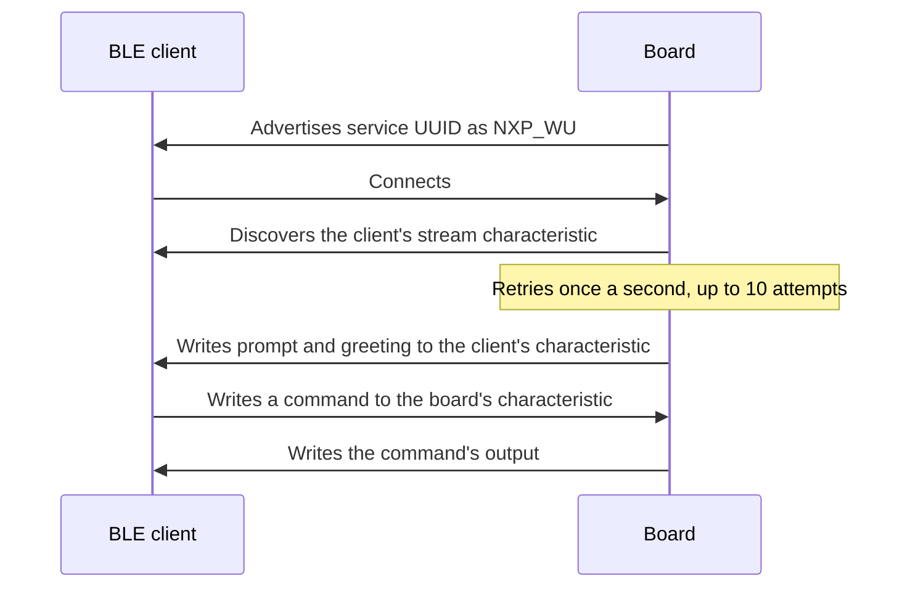
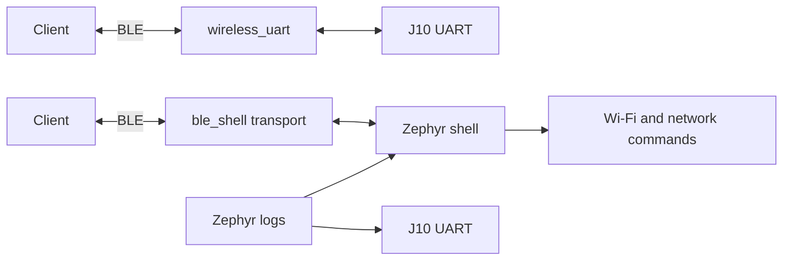

# Architecture

## Workspace layout

The repo is a [west](https://docs.zephyrproject.org/latest/develop/west/index.html)
manifest repository. `make setup` creates the rest of the workspace in its parent
directory, so only the repo itself is under version control:

```
rw612-workspace/
├── RW612-enablement/        This repo
│   ├── apps/                Applications
│   ├── build/<app>/         Build output (not committed)
│   ├── docs/
│   ├── scripts/
│   ├── Makefile
│   └── west.yml             Pins Zephyr and selects the modules to fetch
├── zephyr/                  Zephyr v4.5.0
├── modules/, bootloader/    Modules listed in west.yml, including hal_nxp
├── .venv/                   Python environment with west
├── .west/                   West configuration
└── .tools/                  uv, Python, Zephyr SDK and J-Link
```

The Makefile wraps `west`, and sets `PATH`, `ZEPHYR_BASE` and `ZEPHYR_SDK_INSTALL_DIR`, so
you don't need to activate anything first.

## Radio firmware

The RW612's radios run NXP firmware, which `make blobs` downloads into `modules/hal/nxp`.
When an application enables Wi-Fi or BLE, the build links the matching firmware into the
application image, so flashing the image is enough. BLE images use NXP's combined BLE and
802.15.4 firmware.

## How the BLE console works

NXP's Wireless UART profile uses one service and one characteristic:

| Item | UUID |
|---|---|
| Service | `01ff0100-ba5e-f4ee-5ca1-eb1e5e4b1ce0` |
| Stream characteristic | `01ff0101-ba5e-f4ee-5ca1-eb1e5e4b1ce0` |

Unlike most BLE serial profiles, it doesn't use notifications. **Each side is both a GATT
server and a GATT client**, and writes to the same characteristic on the other side, using
write without response. That's why the board has to discover the service on the connected
device before it can send anything.



Two applications use this profile, and they differ in what the stream connects to:



`apps/ble_shell/src/main.c` has these main parts:

- **Shell transport:** a custom backend that connects the Zephyr shell to BLE. Input from
  the client goes through one ring buffer to the shell. Output goes through another to a
  sender thread.
- **Sender thread:** waits 10 ms so that output is grouped into larger writes, then sends
  it in chunks that fit the negotiated MTU.
- **Line endings:** if a message doesn't end in a line ending, one is added after 200 ms,
  so that the shell runs it. The terminal used for testing sends `\r\n`, so this is
  only a fallback for other clients.
- **Status reporting:** `main()` reports the Wi-Fi status every 30 seconds, and early when
  a network event wakes it. A newly connected client also gets the greeting.

The console logs through the shell's log backend, which drops messages rather than waiting
if its buffer is full. J10 logging therefore doesn't depend on the BLE link.

The profile follows
[NXP's Wireless UART example](https://github.com/nxp-mcuxpresso/mcuxsdk-middleware-bluetooth-host/tree/main/examples/w_uart),
which targets NXP's own Bluetooth stack on other chips. The code here is a separate
implementation on Zephyr's Bluetooth stack.

`wireless_uart` and `ble_shell` currently duplicate the discovery and sending code. Moving
it to a shared module would be a sensible cleanup if a third application needs it.

## Adding an application

1. Create `apps/<name>/` with `CMakeLists.txt`, `prj.conf` and `src/main.c`. `apps/blinky`
   is the smallest example.
2. To give it a short name, add `APP_PATH_<name> := $(REPO)/apps/<name>` to the `Makefile`,
   and add it to the `build-all` target and the `make help` text.
3. Build it with `make build APP=<name>`.

To use the BLE console from a new application, start from `apps/ble_shell`. If it needs a
Zephyr module that isn't fetched yet, add the module to `name-allowlist` in `west.yml` and
run `make setup`.
